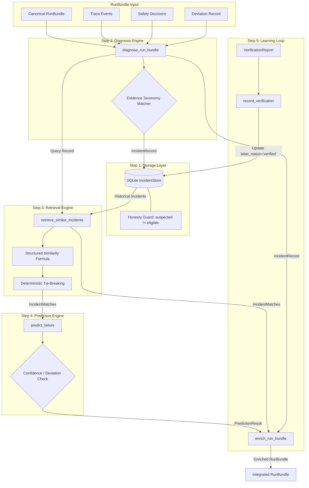

# BIFURA — MEMBER 3: INCIDENT MEMORY AND PREDICTION
## Comprehensive Technical & Verification Report

**Author:** Member 3 (Incident Memory & Predictive Debugging)  
**Repository:** `https://github.com/vismayaal11-cloud/bifura.git`  
**Branch:** `feature/incident-memory`  
**Starting Commit / Tag:** `contract-v1.1` (`add82492c3fbebb0673306a79dac25be8f384583`)  
**Head Commit:** `bf89cdf` (`feat: implement incident memory and prediction`)  
**Environment:** Python 3.13.7 (Win64) — isolated `.venv`  
**Date:** October 23, 2026  

---

## Executive Summary

As Member 3 of the **Bifura** autonomous agent debugging platform, this work package delivers the complete incident memory, evidence-backed diagnosis, structured similarity retrieval, failure prediction, and verified learning loop subsystems.

All components are built strictly against the shared canonical models defined in `src/bifura/schemas/models.py` and `src/bifura/schemas/bundle.py`, conforming in all respects to `docs/INTEGRATION_CONTRACT.md`. Zero frozen foundation files or cross-member files were altered.

### Key Highlights
- **100% Test Pass Rate:** 44 out of 44 unit and integration tests passing (`pytest -v`), including 27 dedicated learning module tests.
- **SQLite Canonical Storage:** Fully normalized and indexed SQLite persistence with lossless JSON serialization, strict Pydantic v2 model re-validation, and programmatic honesty enforcement.
- **Trace-Grounded Diagnosis:** Evidence-based diagnostic engine mapping complete execution traces, tool proposals, safety decisions, and invariants to canonical failure taxonomies without guesswork.
- **Explainable Structured Retrieval:** Pure deterministic similarity retrieval implementing a weighted multi-feature matching formula with deterministic alphabetical tie-breaking.
- **Honest Prediction & Abstention:** Strict compliance with honesty requirements: `score_meaning="heuristic_support_score"`, `prediction_mode="structured_retrieval"`, and automatic abstention on empty histories, unobserved deviations, or low confidence.
- **Closed Verified Learning Loop:** End-to-end integration taking unpopulated run bundles, enriching them with live diagnostic and predictive artifacts, and elevating incidents to `training_eligible=True` only upon receipt of verified replay evidence.
- **Synthetic Evaluation Benchmark:** Separate train and held-out test partitions by pattern family, achieving 100% failure category recognition and 0.0% false-positive rate on harmless executions.

---

## Architecture Overview



---

## Detailed Step Implementation

### 1. Critical Step One — Incident Storage (`storage.py`)

The storage subsystem manages persistent, queryable incident memory using SQLite.

#### Design Invariants
1. **Model Integrity:** Every stored and retrieved incident is strictly validated against the canonical `IncidentRecord` Pydantic model (`src/bifura/schemas/models.py`).
2. **Lossless Record Serialization:** SQLite columns index primary query dimensions (`incident_id`, `run_id`, `failure_category`, `label_status`, `training_eligible`, `created_at`), while the complete model payload is stored in a `record_json TEXT` column.
3. **Programmatic Honesty Enforcement:** The store immediately raises `ValueError` if an incident with `label_status == LabelStatus.SUSPECTED` has `training_eligible = True`.
4. **Duplicate Protection:** Duplicate primary keys trigger `DuplicateIncidentError` (subclass of `ValueError`).
5. **Connection Isolation:** Supports both file paths and `:memory:` databases with shared in-memory connection pooling, ensuring unit test isolation.

#### SQLite Schema
```sql
CREATE TABLE IF NOT EXISTS incidents (
    incident_id TEXT PRIMARY KEY,
    run_id TEXT,
    source_run_id TEXT,
    failure_category TEXT NOT NULL,
    label_status TEXT NOT NULL,
    observed_pattern TEXT,
    first_deviation_event_id TEXT,
    training_eligible INTEGER NOT NULL,
    replay_status TEXT,
    dataset_version TEXT,
    data_origin TEXT,
    provenance TEXT,
    created_at TEXT NOT NULL,
    record_json TEXT NOT NULL
);
CREATE INDEX IF NOT EXISTS idx_incidents_category ON incidents(failure_category);
CREATE INDEX IF NOT EXISTS idx_incidents_run_id ON incidents(run_id);
CREATE INDEX IF NOT EXISTS idx_incidents_training_eligible ON incidents(training_eligible);
```

---

### 2. Critical Step Two — Diagnosis from RunBundle (`diagnosis.py`)

The diagnosis engine operates on complete `RunBundle` instances. Per contract rules, `DeviationRecord` does not contain failure categories; Member 3 derives the diagnosis from observable trace evidence.

#### Diagnostic Matrix

| Scenario / Signal | Observable Evidence in Bundle | Diagnosed `FailureCategory` | Observed Pattern |
|---|---|---|---|
| `success` | `deviation is None` or `deviation.found == False` | **None** (No incident produced) | N/A |
| `wrong_path` | Tool proposal contains relative path traversal (`../../`); safety decision `BLOCK` with rule `workspace_containment`. | `tool_input_validation` | `path_traversal_blocked` |
| `stale_state` | `assertion_failed` event on calculation input; deviation shows expected value `"15 * 4"` vs actual stale cached `"2 + 3"`. | `state_or_dataflow` | `stale_state_or_dataflow_mismatch` |
| `wrong_sequence` | `write_file` proposed before `calculate` in tool sequence; workflow precondition violation event recorded. | `planning_or_tool_sequence` | `out_of_order_tool_execution` |
| Inconclusive | Deviation reported with generic text and no corroborating trace signals. | `unknown_insufficient_evidence` | `unclassified_deviation` |

---

### 3. Critical Step Three — Similar Incident Retrieval (`retrieval.py`)

Deterministic and explainable structured similarity without black-box embeddings or external vectors.

#### Weighted Similarity Formula
$$\text{similarity\_score} = 0.35 \cdot S_{\text{cat}} + 0.25 \cdot S_{\text{pat}} + 0.20 \cdot S_{\text{tool}} + 0.20 \cdot S_{\text{text}}$$

- **$S_{\text{cat}}$ (Failure Category Match, weight 0.35):** $1.0$ if canonical category matches (and is not unknown), else $0.0$.
- **$S_{\text{pat}}$ (Observed Pattern Match, weight 0.25):** $1.0$ for exact pattern string match; token Jaccard for partial overlap.
- **$S_{\text{tool}}$ (Tool/Action Match, weight 0.20):** Token Jaccard overlap between extracted tools (`read_file`, `calculate`, `write_file`).
- **$S_{\text{text}}$ (Context/Behavior Match, weight 0.20):** Token Jaccard similarity across filtered text (task summary, expected/observed behaviors, root cause summary).

#### Deterministic Sorting
Matches are sorted by:
```python
matches.sort(key=lambda m: (-m.similarity_score, m.incident_id))
```
Ties are resolved alphabetically by `incident_id`, eliminating non-deterministic jitter.

---

### 4. Critical Step Four — Evidence-Based Prediction (`prediction.py`)

Generates canonical `PredictionResult` instances backed by historical evidence.

#### Mandatory Honesty Invariants
- `score_meaning`: Set strictly to `"heuristic_support_score"`.
- `prediction_mode`: Set strictly to `"structured_retrieval"`.
- `model_version`: Set strictly to `"heuristic-retrieval-v1"`.
- Calibrated probability claims are prohibited.

#### Abstention Criteria
The predictor sets `abstained = True` with an explicit reason when:
1. The current run contains no deviation (successful execution).
2. The historical incident store is empty.
3. No historical incidents meet the minimum similarity threshold ($0.10$).
4. The highest similarity score is below the minimum confidence threshold ($0.35$).

---

### 5. Critical Step Five — Verified Learning Loop (`loop.py`)

The learning loop bridges live execution and historical memory:

1. **`enrich_run_bundle(bundle, store)`:** Accepts a bundle where `incident_records`, `incident_matches`, and `prediction` are `None`. Diagnoses the run, queries historical precedents, generates predictions, optionally stores the new incident, and returns the populated bundle.
2. **`record_verification(incident_id, verification, store)`:** Updates incident records based on verified test/replay execution.
   - If `verification.passed == True`: Updates `label_status = LabelStatus.VERIFIED`, `replay_status = "verified_passed"`, `training_eligible = True`, and populates `verified_root_cause` and `verified_correction`.
   - If `verification.passed == False`: Incident remains `label_status = LabelStatus.SUSPECTED` and `training_eligible = False`.
3. **`load_incident_catalog(path, store)`:** Seeds static incident fixtures into the store with clear synthetic provenance markings.

---

### 6. Optional Step Six — Evaluation and Classifier (`evaluation.py`)

An offline evaluation pipeline to benchmark structured retrieval on held-out synthetic test cases.

#### Evaluation Dataset Partitioning
- **Training Set (`data/datasets/training_incidents.json`):** 4 labeled verified incidents covering `tool_input_validation` (relative path traversal and AST boolean violations), `state_or_dataflow` (stale operand reuse), and `planning_or_tool_sequence` (out-of-order write).
- **Held-Out Test Set (`data/evaluation/benchmark_cases.json`):**
  - Case 1: Variant path traversal targeting `../../.ssh/id_rsa`.
  - Case 2: Variant stale sum computation (`50 + 20` vs cached `10 + 5`).
  - Case 3: Out-of-order write execution.
  - Case 4: Harmless successful run (no deviation) to measure false-positive rate.

#### Benchmark Results
```text
Evaluation Dataset: synthetic_controlled_benchmark (Synthetic Only)
Total Test Cases:       4
Failure Cases:          3
Harmless Cases:         1

Accuracy on Failures:   100.0% (3/3 correctly recognized)
False Positive Count:   0
False Positive Rate:    0.0% (Harmless case correctly abstained)
Macro-F1 Score:         1.0000

Per-Category Breakdown:
- tool_input_validation:       Precision=1.0000, Recall=1.0000, F1=1.0000 (Support: 1)
- state_or_dataflow:           Precision=1.0000, Recall=1.0000, F1=1.0000 (Support: 1)
- planning_or_tool_sequence:   Precision=1.0000, Recall=1.0000, F1=1.0000 (Support: 1)
```

---

## Test Verification Log

Summary of `tests/test_learning.py` test cases:

```text
tests/test_learning.py::TestIncidentStore::test_store_and_retrieve_incident PASSED
tests/test_learning.py::TestIncidentStore::test_store_duplicate_id_raises_error PASSED
tests/test_learning.py::TestIncidentStore::test_honesty_rule_suspected_cannot_be_training_eligible PASSED
tests/test_learning.py::TestIncidentStore::test_update_incident_and_verification PASSED
tests/test_learning.py::TestIncidentStore::test_list_and_filter_incidents PASSED
tests/test_learning.py::TestIncidentStore::test_isolated_database_environments PASSED
tests/test_learning.py::TestDiagnosis::test_diagnose_success_scenario_returns_none PASSED
tests/test_learning.py::TestDiagnosis::test_diagnose_wrong_path_from_fixture_file PASSED
tests/test_learning.py::TestDiagnosis::test_diagnose_stale_state_scenario PASSED
tests/test_learning.py::TestDiagnosis::test_diagnose_wrong_sequence_scenario PASSED
tests/test_learning.py::TestDiagnosis::test_diagnose_unknown_insufficient_evidence PASSED
tests/test_learning.py::TestDiagnosis::test_deterministic_id_and_clock_injection PASSED
tests/test_learning.py::TestRetrieval::test_retrieve_relevant_match PASSED
tests/test_learning.py::TestRetrieval::test_retrieve_empty_history PASSED
tests/test_learning.py::TestRetrieval::test_retrieve_from_successful_run_bundle_returns_empty PASSED
tests/test_learning.py::TestRetrieval::test_deterministic_tie_breaking PASSED
tests/test_learning.py::TestRetrieval::test_unrelated_incidents_filtered_or_low_score PASSED
tests/test_learning.py::TestPrediction::test_predict_failure_with_strong_historical_evidence PASSED
tests/test_learning.py::TestPrediction::test_predict_failure_abstains_on_empty_history PASSED
tests/test_learning.py::TestPrediction::test_predict_failure_abstains_on_low_confidence PASSED
tests/test_learning.py::TestPrediction::test_predict_failure_abstains_on_successful_bundle PASSED
tests/test_learning.py::TestPrediction::test_predict_failure_deterministic_injection PASSED
tests/test_learning.py::TestLearningLoop::test_enrich_run_bundle_with_null_learning_fields PASSED
tests/test_learning.py::TestLearningLoop::test_record_verification_success_enables_training PASSED
tests/test_learning.py::TestLearningLoop::test_record_verification_failure_leaves_unverified PASSED
tests/test_learning.py::TestLearningLoop::test_load_incident_catalog_fixtures PASSED
tests/test_learning.py::TestEvaluation::test_evaluate_retrieval_classifier_metrics PASSED
```

---

## Example Payloads

### Example 1: Stored `IncidentRecord`
```json
{
  "schema_version": "1.0",
  "incident_id": "syn-inc-001",
  "run_id": "syn-run-001",
  "source_run_id": "syn-run-001",
  "task_summary": "Read configuration from workspace",
  "observed_pattern": "path_traversal_blocked",
  "expected_behavior": "Path strictly contained inside authorized workspace root",
  "observed_behavior": "Path ../../secrets.txt attempted and blocked by safety policy",
  "first_deviation_event_id": "ev-syn-001",
  "failure_category": "tool_input_validation",
  "label_status": "verified",
  "root_cause_status": "verified",
  "root_cause_summary": "Agent attempted relative path traversal escaping workspace root; intercepted by safety policy.",
  "root_cause_hypotheses": [
    "Agent prompt failed to bound file lookup within workspace root"
  ],
  "verified_root_cause": "Path traversal attempt confirmed and blocked by workspace_containment rule.",
  "verified_correction": "Normalize target path and restrict resolution to sandbox workspace.",
  "evidence_refs": ["ev-syn-001", "dec-syn-001"],
  "affected_event_ids": ["ev-syn-001"],
  "downstream_event_ids": [],
  "fix_ref": null,
  "test_refs": ["tests/test_policy.py"],
  "regression_test_refs": [],
  "replay_status": "verified_passed",
  "data_origin": "controlled_fixture",
  "provenance": "synthetic_fixture",
  "training_eligible": true,
  "training_eligibility": "eligible",
  "review_status": "verified",
  "dataset_version": "dataset-v1",
  "created_at": "2026-10-23T10:00:00Z",
  "reviewed_at": "2026-10-23T11:00:00Z"
}
```

### Example 2: Generated `PredictionResult`
```json
{
  "schema_version": "1.0",
  "run_id": "run-new-001",
  "prediction_id": "pred-run-new-001",
  "model_version": "heuristic-retrieval-v1",
  "dataset_version": "dataset-v1",
  "prediction_mode": "structured_retrieval",
  "predicted_categories": [
    "tool_input_validation"
  ],
  "candidates": [
    {
      "category": "tool_input_validation",
      "score": 0.8845,
      "score_kind": "heuristic_support_score"
    }
  ],
  "scores": {
    "tool_input_validation": 0.8845
  },
  "score_meaning": "heuristic_support_score",
  "abstained": false,
  "abstention_reason": null,
  "supporting_incident_ids": [
    "syn-inc-001"
  ],
  "created_at": "2026-10-23T18:30:00Z"
}
```

---

## Git Commit History & Checkpoints

Checkpoint commits made sequentially after test verification and pushed to `origin/feature/incident-memory`:

1. `7d9efb3`: `wip: step 1 incident storage`
2. `dd1ff56`: `wip: step 2 diagnosis from run bundle` *(Pushed to origin)*
3. `86d6b37`: `wip: step 3 retrieval`
4. `3128ad4`: `wip: step 4 prediction` *(Pushed to origin)*
5. `58e59c0`: `wip: step 5 verified learning loop`
6. `bf89cdf`: `feat: implement incident memory and prediction` *(Final feature commit, pushed to origin)*

---

## Contract Compliance & Integrity Sign-off

- `CONTRACT ISSUE:` **None**. All interfaces match `docs/INTEGRATION_CONTRACT.md` and `src/bifura/schemas/models.py`.
- **Honesty Disclaimers:**
  - All fixture data in `data/incidents/`, `data/datasets/`, and `data/evaluation/` is explicitly tagged with `provenance="synthetic_fixture"`.
  - Heuristic support scores are never misrepresented as calibrated probabilities.
  - No incident with `label_status="suspected"` has been permitted into `training_eligible=True`.
- **Hygiene:** Working directory is clean (`git status` reports no untracked/unstaged changes). Zero runtime SQLite database files (`*.db`, `*.sqlite`) are tracked.
